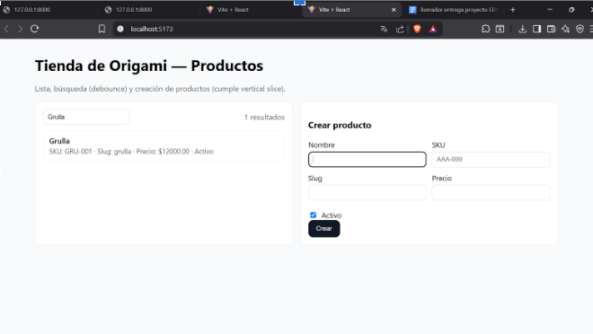
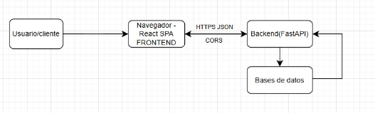
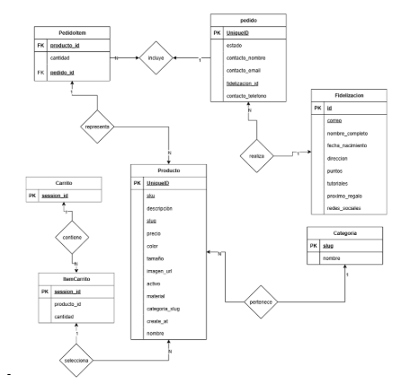

# Origami Store — Tienda web de origami artesanal

Tienda en línea para un emprendimiento de origami 3D: catálogo de productos, carrito, pedidos estándar y personalizados, programa de fidelización y un panel de administración. Es una SPA en React que consume una API REST en FastAPI con autenticación JWT y roles.

> Proyecto académico — Estructuras de Datos y Algoritmos 2, Universidad Autónoma de Occidente (2025).
> Este repositorio es un **esquema expositivo**: muestra el problema, la arquitectura, el modelo de datos y las decisiones técnicas. El código fuente completo se mantiene privado.

🔗 **Demo:** [baloco-origami-store.web.app](https://baloco-origami-store.web.app) *(el backend de la demo está en corrección)*

## El problema

Personas y negocios quieren figuras de origami 3D, pero no encuentran un catálogo claro ni una forma sencilla de pedir o personalizar. La tienda resuelve eso para tres públicos: clientes finales (regalos y decoración), comercios (volumen y branding) y el taller (gestión interna).

## Funcionalidades

**Cliente**
- Navegar el catálogo, filtrar por categoría (Origami 3D, Filigrana, Tradicional) y ver el detalle de cada producto.
- Carrito de compras, incluso sin iniciar sesión.
- Pedido estándar (checkout), pedido personalizado y pedido de productos no disponibles.
- Seguimiento del estado del pedido: revisión → elaborando → terminado → despachado.
- Programa de fidelización con puntos, tutoriales exclusivos y regalos.

**Administrador**
- CRUD de productos con carga de imágenes y activación/desactivación.
- Revisión de pedidos, cambio de estado y comentarios al cliente.
- Consulta de clientes fidelizados.

## Arquitectura

| Capa | Tecnología |
|---|---|
| Frontend | React 19 + Vite 7, rutas protegidas (`ProtectedRoute`, `AdminRoute`) |
| Backend | FastAPI, routers por dominio, validación con Pydantic |
| Datos | SQLAlchemy + SQLite |
| Autenticación | OAuth2 Password + JWT (HS256), roles cliente/administrador |
| Despliegue | Frontend en Firebase Hosting; backend en contenedor Docker con Cloud Build y Cloud Run |
| CI | GitHub Actions |

### API (resumen)

| Recurso | Endpoints |
|---|---|
| Autenticación | `POST /api/auth/register`, `POST /api/auth/login` |
| Productos (admin) | `/api/productos` — CRUD y subida de imágenes |
| Pedidos | `/api/pedidos/*` — estándar y personalizados |
| Carrito | `/api/carrito/*` |
| Salud | `GET /health` |

Reglas de negocio destacadas: un pedido entregado no se puede cancelar, y las rutas de administración exigen el rol `admin` (`require_admin`).

## Modelo de datos

Entidades principales: **Producto**, **Categoría**, **Pedido** y **PedidoItem**, **Carrito** e **ItemCarrito**, y **Fidelización**.

## Seguridad: lecciones aprendidas

Al revisar el proyecto para publicarlo identifiqué riesgos típicos de un desarrollo académico que aplicaría desde el inicio en un proyecto real:

- **Secretos fuera del código:** la clave de firma de los JWT debe venir de una variable de entorno o de un gestor de secretos, nunca escrita en `config.py`.
- **Datos fuera del repositorio:** bases de datos, imágenes subidas por usuarios y entornos virtuales van en `.gitignore`.
- **Despliegue con mínimo privilegio:** si el servicio queda público (`--allow-unauthenticated`), la autorización tiene que depender por completo de tokens firmados con una clave privada.

Por estas razones el código completo quedó privado y este repositorio funciona como vitrina.

## Equipo

Juan José Baloco Sánchez · David Astudillo · Santiago Vivas
